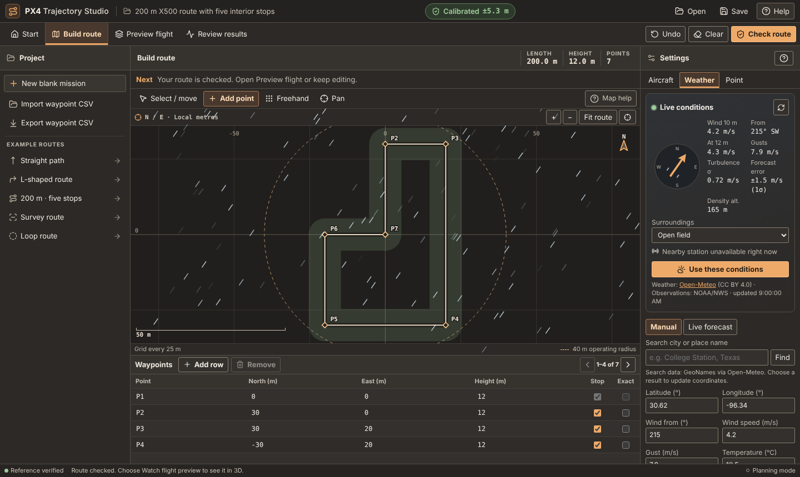
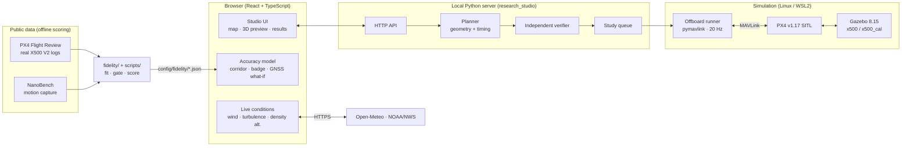
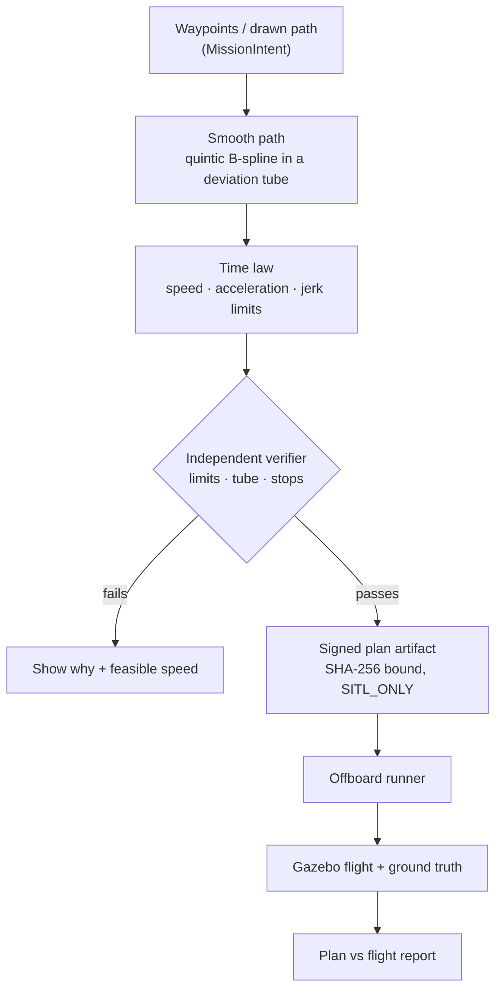
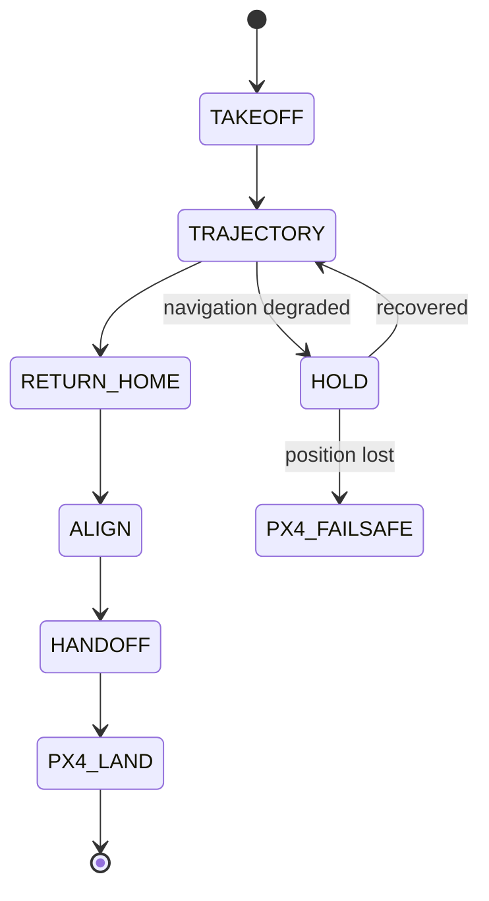
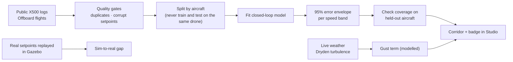
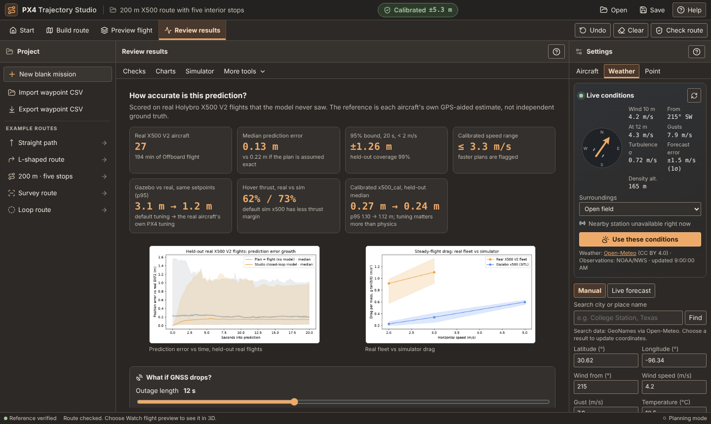
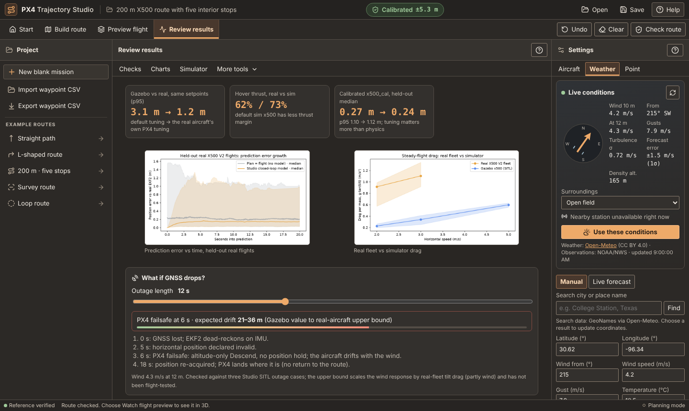

# PX4 Trajectory Studio

**Draw a drone route, check it, preview the flight, and see how accurately a real X500 would fly it, before anyone goes outside.**

Built for the Holybro X500 V2 on PX4 v1.17 with Gazebo 8.15. The planner and safety checks are independent of the simulator; Gazebo is used to fly the result.



| | |
|---|---|
| **Plan** | Draw or type waypoints; the planner builds a smooth, speed/acceleration/jerk-limited trajectory and an independent verifier checks it. |
| **Predict** | Every route gets a 95% accuracy corridor scored on **real X500 V2 flights** it never saw (public PX4 logs). |
| **Weather** | Live conditions (Open-Meteo + nearest NOAA station), wind at flight altitude, turbulence, forecast uncertainty, animated wind. |
| **Simulate** | One click flies the verified plan in PX4 SITL + Gazebo and compares plan vs simulated flight. |
| **Be honest** | A badge shows *Calibrated / Extrapolating / Uncalibrated*; the Accuracy evidence tab shows the data behind every number. |

---

## Run it in your browser (about 5 minutes)

Needs **Python 3.10+** and **Node.js 22+**. No PX4 or Gazebo needed for planning.

```bash
git clone https://github.com/XpiredRuby/PX4_project_improved.git
cd PX4_project_improved
git checkout docs/clean-readme            # this branch

python -m pip install -r requirements.txt
cd studio-v2 && npm ci && npm run build && cd ..

python -m mission_planner.research_studio --port 8767 --studies-dir ~/px4-studio-studies
```

Open **http://127.0.0.1:8767**, choose **Build route → 200 m · five stops**, then **Check route**.
Live weather needs an internet connection; everything else runs locally.

<details><summary>Optional: connect PX4 SITL + Gazebo (Linux / WSL2)</summary>

Follow [`docs/trajectory_studio_handbook.md`](docs/trajectory_studio_handbook.md): build PX4 v1.17 SITL, register the
aircraft with `mission_planner.simulation_binding`, then start the studio with `--sitl-autopilot` and `--sim-binding`.
Optional extras: `--sitl-tuning-params your.params` (use your aircraft's own PX4 tuning) and
`scripts/install_x500_cal.py` (calibrated Gazebo x500).
</details>

---

## How it is built



### From a drawing to a flight



### What the aircraft does in a mission



### How the accuracy numbers are earned



---

## Results so far

| Question | Answer | Evidence |
|---|---|---|
| How well does Studio predict a real X500 from its setpoints? | Median error **0.13 m** vs 0.22 m if you assume the plan is flown exactly | [x500 public logs](validation/2026-11-23-x500-public-logs/README.md) |
| Does the 95% bound hold on drones it never saw? | Yes below 2 m/s (held-out coverage ~99%); faster flight is flagged | same |
| What is the biggest simulator-vs-reality gap? | **Controller tuning.** Using the real aircraft's PX4 tuning cuts Gazebo's p95 error from 3.1 m to 1.2 m | same, section 2 |
| Is the Gazebo x500 physically right? | Close but optimistic: motors respond 4-15x faster than real ones; calibrated `x500_cal` provided | same, sections 3 and 5 |
| What if GPS drops for 12 s in 6.7 m/s wind? | PX4 failsafe descent drifts **32-55 m**; reproduced on three SITL cases | Accuracy evidence tab |

|  |  |
|---|---|
| Accuracy evidence tab | GNSS-outage what-if |

**Honest limits.** Public X500 logs carry the drone's own GPS-based estimate, not independent truth, and no measured wind.
The wind term in the corridor is modelled, not yet checked against measured wind. Nothing here has flown a physical aircraft; all output is `SITL_ONLY`.
The next step is a few supervised X500 flights with RTK GPS and a ground anemometer.

---

## Repository map

| Folder | What is inside |
|---|---|
| `studio-v2/` | The Studio web app (React + TypeScript) |
| `mission_planner/` | Planner, verifier, HTTP server, aircraft profiles, SITL binding |
| `controller/` | PX4 Offboard runner (pymavlink), mission phases, safety checks |
| `fidelity/` | Real-flight loaders, identification and scoring (public datasets) |
| `scripts/` | Command-line tools: SITL campaigns, log mining, replay, scoring |
| `analysis/` | Post-flight analysis and plotting |
| `config/`, `schemas/`, `missions/` | Planner settings, JSON schemas, example missions; `config/fidelity` drives the accuracy UI |
| `validation/` | Dated evidence folders, each with a README |
| `evidence/` | Retained plan artifacts and the archived X500 flight |
| `docs/` | Handbook, architecture, safety, reproducibility |
| `tests/` | 469 Python tests (plus 40 frontend tests in `studio-v2/tests`) |
| `web/`, `trajectory_generator/` | Portable browser planner build; original trajectory generator |

## Check everything

```bash
python -m pip install -r requirements-dev.txt
python -m pytest -q                 # 469 tests
python -m ruff check mission_planner controller analysis scripts tests fidelity
cd studio-v2 && npm test            # 40 tests
```

Safety: see [`docs/SAFETY.md`](docs/SAFETY.md). Physical flights require the supervised release process in
[`docs/physical_flight_release.md`](docs/physical_flight_release.md).
