<div align="center">

# PX4 Trajectory Studio

**Draw a drone route, check it, preview the flight, and see how accurately a real Holybro X500 V2 would fly it, before anyone goes outside.**

     

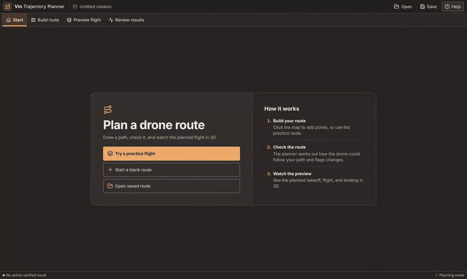

</div>

> [!TIP]
> **Professors / reviewers:** run it on your laptop in two minutes with [Option A](#option-a-ready-to-run-zip-no-nodejs).
> Then click **Try a practice flight → Check route → Watch flight preview**. No PX4, Gazebo or drone needed.

## Contents

| | |
|---|---|
| 🚀 [Run it on your laptop](#run-it-on-your-laptop) | Two ways, both open in your browser at `http://127.0.0.1:8767` |
| 🖼️ [Guided tour](#guided-tour) | What each screen does |
| 🏗️ [How it is built](#how-it-is-built) | System architecture and where each part lives in this repo |
| 🎯 [How accurate is it?](#how-accurate-is-it) | Results on real public flight data, with honest limits |
| 🗂️ [Repository map](#repository-map) | Which folder to open for what |

---

## Run it on your laptop

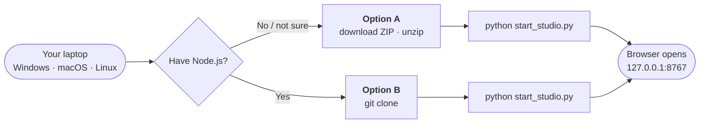

### Option A: ready-to-run ZIP (no Node.js)

Needs only **Python 3.10+** ([python.org](https://www.python.org/downloads/)).

1. Download **`PX4-Trajectory-Studio.zip`** from the [latest release](https://github.com/XpiredRuby/PX4_project_improved/releases/latest) and unzip it.
2. Open a terminal **in the unzipped folder** and run:

   ```bash
   python -m pip install numpy pyulog
   python start_studio.py          # Windows: py start_studio.py
   ```
3. Open **http://127.0.0.1:8767**.

<details><summary>Cannot install packages? Browser-only mode</summary>

In the unzipped folder run any static server, e.g. `python -m http.server 8767 --bind 127.0.0.1`, and open the same address.
The planner then runs inside the browser (bundled Python + NumPy). Background studies are unavailable in this mode.
</details>

### Option B: from source

Needs **Python 3.10+**, **Git** and **Node.js 22+** ([nodejs.org](https://nodejs.org)).

```bash
git clone -b docs/clean-readme https://github.com/XpiredRuby/PX4_project_improved.git
cd PX4_project_improved
python start_studio.py             # Windows: py start_studio.py
```

`start_studio.py` installs the Python packages (asks first), builds the web app on the first run, starts the local
server and opens your browser. Stop it with **Ctrl+C**. Live weather needs internet; everything else runs on your laptop.

<details><summary>Optional: fly plans in PX4 SITL + Gazebo (Linux / WSL2)</summary>

Follow [`docs/trajectory_studio_handbook.md`](docs/trajectory_studio_handbook.md): build PX4 v1.17 SITL, register the
aircraft with `python -m mission_planner.simulation_binding`, then start with `--sitl-autopilot`, `--runs` and `--sim-binding`.
Extras: `--sitl-tuning-params your.params` (fly Gazebo with a real aircraft's PX4 tuning) and
`scripts/install_x500_cal.py` (Gazebo x500 recalibrated from real flights).
</details>

---

## Guided tour

| ① Start | ② Build route |
|---|---|
|  | 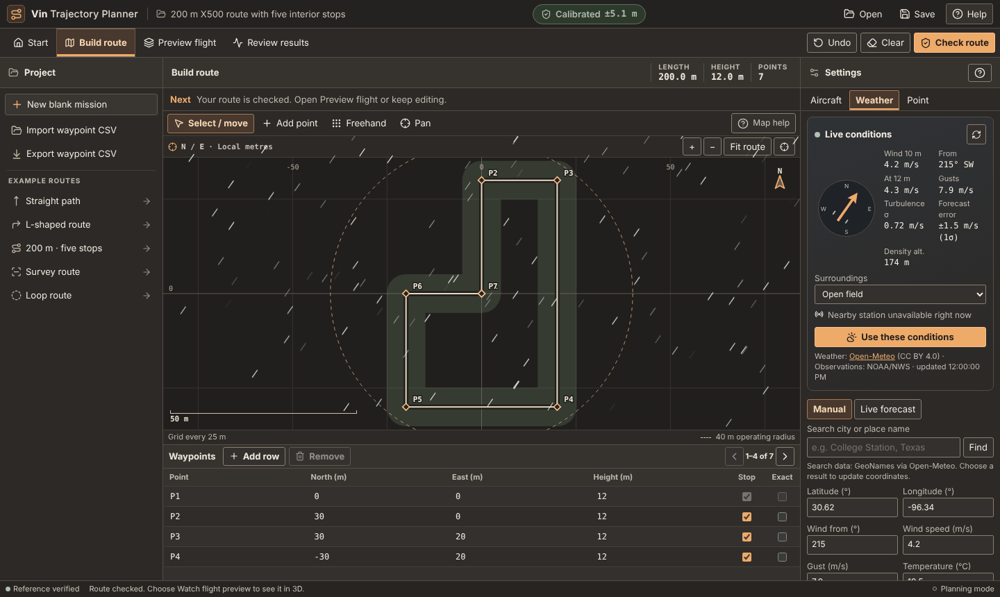 |
| Pick a practice route, a blank route, or a saved one. | Click to add points or load an example. The **shaded band** is the 95% accuracy corridor; streaks are the wind; the right panel pulls **live weather**. |
| **③ Check & review** | **④ Preview in 3D** |
| 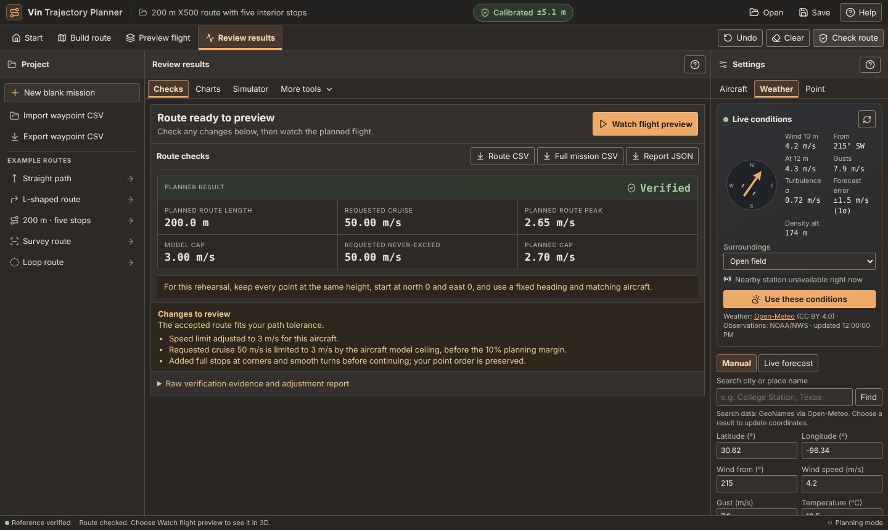 | 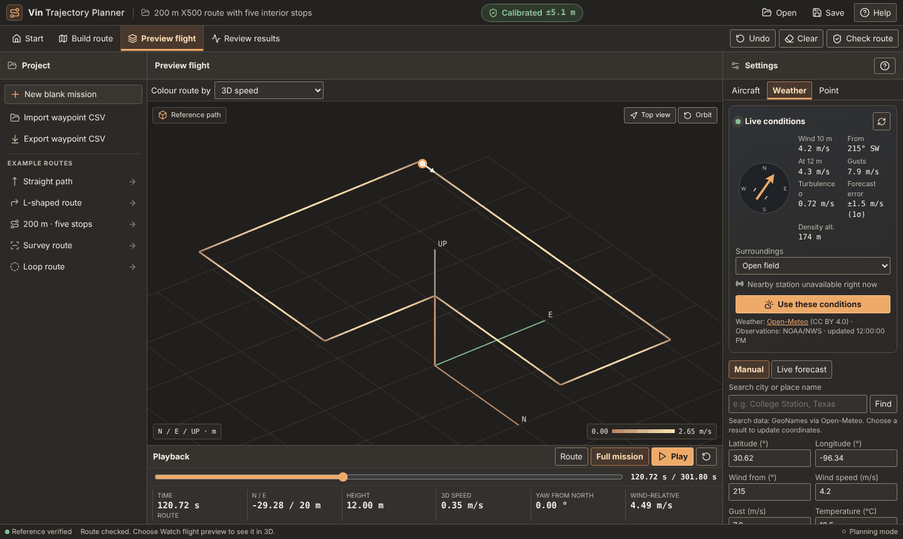 |
| **Check route** runs the planner and an independent verifier, then lists every change it made (speed caps, added stops) and why. | Plays the full mission (takeoff, route, return, landing) with speed colouring and a scrub bar. |

| ⑤ Accuracy evidence (Review results → More tools) | ⑥ GNSS-outage what-if |
|---|---|
| 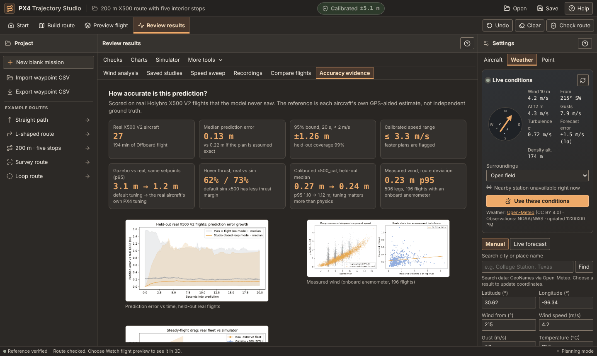 |  |
| The data behind every accuracy number, including plots from real flights. | How far PX4's failsafe descent drifts if GPS drops for *N* seconds in today's wind. |

The badge at the top (**Calibrated / Extrapolating / Uncalibrated**) says whether your route stays inside what real
flight data covers. Faster or windier than the data → the badge changes and says why.

---

## How it is built

<p align="center">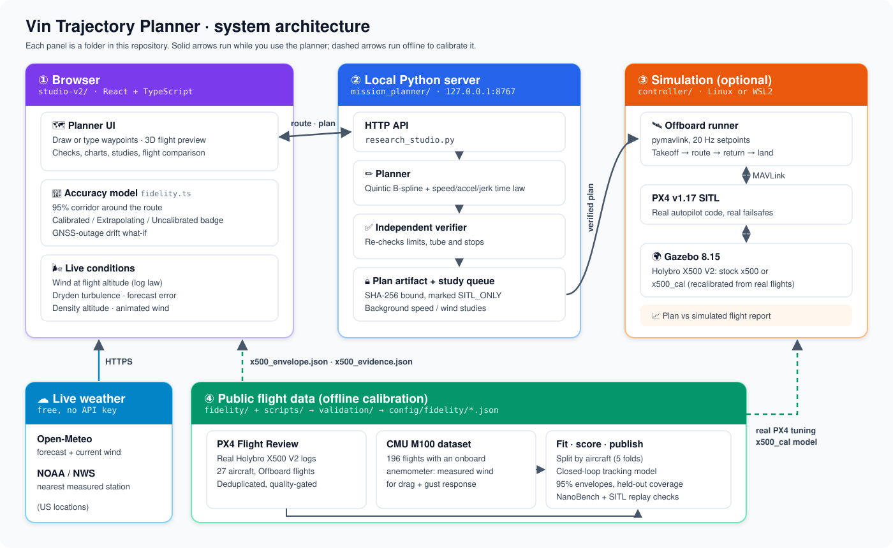</p>

<p align="center">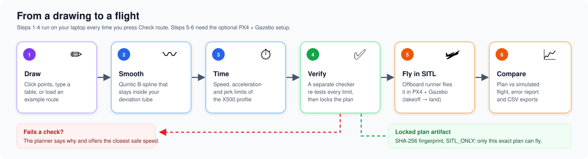</p>

### What the aircraft does in a mission

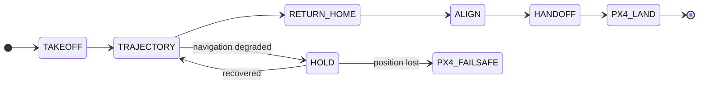

---

## How accurate is it?

Every number below is scored on **public flight data the model never trained on** (split by aircraft, so no drone is
in both training and test). Nothing here has flown a physical aircraft; all output is marked `SITL_ONLY`.

<p align="center">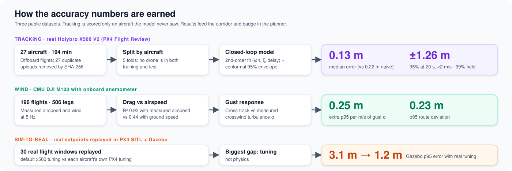</p>

| Question | Answer | Evidence |
|---|---|---|
| How well does Studio predict a real X500 from its setpoints? | Median error **0.13 m**, vs 0.22 m if you assume the plan is flown exactly | [X500 public logs](validation/2026-11-23-x500-public-logs/README.md) |
| Does the 95% bound hold on drones it never saw? | Yes below 2 m/s: **±1.26 m** at 20 s, 99% held-out coverage. Faster plans are flagged | same |
| How much does wind push it off the route? | **0.25 m** extra (p95) per m/s of gust σ, from 196 flights with a measured-wind sensor | [Measured wind](validation/2026-11-23-measured-wind/README.md) |
| What is the biggest simulator-vs-reality gap? | **Controller tuning.** The real aircraft's PX4 tuning cuts Gazebo's p95 error from 3.1 m to 1.2 m | [X500 public logs](validation/2026-11-23-x500-public-logs/README.md) |
| Is the Gazebo x500 physically right? | Close but optimistic: hover thrust 73% sim vs 62% real; motors respond faster than real ones. A recalibrated `x500_cal` is included | same |
| What if GPS drops for 12 s in 6.7 m/s wind? | PX4's failsafe descent drifts **32-55 m**; reproduced on three SITL cases | Accuracy evidence tab |

All evidence folders are indexed in [`validation/README.md`](validation/README.md).

| Prediction error on held-out real flights | Measured wind: drag and gust response |
|---|---|
| 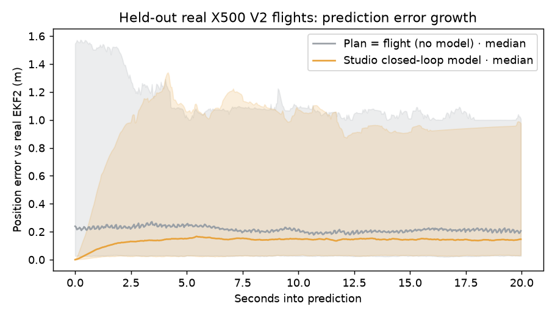 | 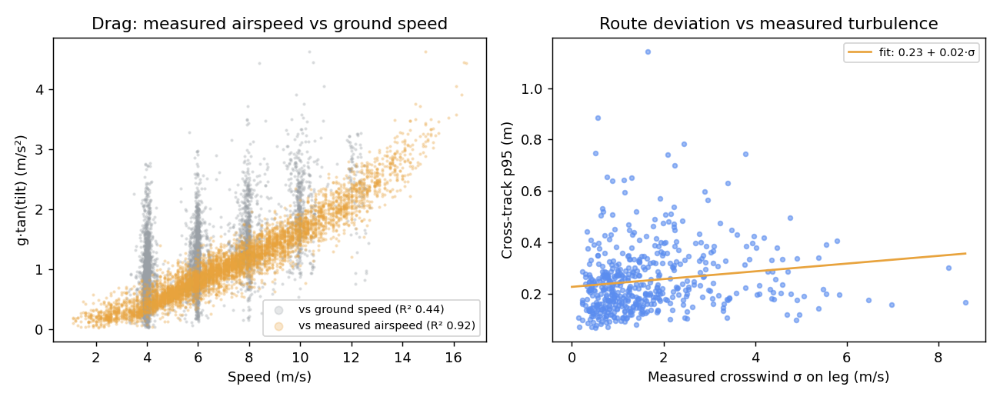 |

> [!IMPORTANT]
> **Honest limits.** X500 logs carry the drone's own GPS-based estimate, not independent truth, and no wind measurement.
> The gust term comes from a different quadcopter (DJI M100). The next step is a few supervised X500 flights with RTK GPS
> and a ground anemometer; the [physical release process](docs/physical_flight_release.md) defines what must pass first.

---

## Repository map

| Folder | Open it for |
|---|---|
| 🖥️ [`studio-v2/`](studio-v2) | The web app (React + TypeScript) |
| 🐍 [`mission_planner/`](mission_planner) | Planner, verifier, local server, aircraft profiles, simulator binding |
| 🛩️ [`controller/`](controller) | PX4 Offboard runner, mission phases, safety checks |
| 📊 [`fidelity/`](fidelity) | Loaders and model fitting for the public flight datasets |
| ⚙️ [`scripts/`](scripts) | Command-line tools: SITL campaigns, log mining, replay, scoring |
| ✅ [`validation/`](validation) | Dated evidence folders, each with its own README and plots |
| 📚 [`docs/`](docs) | [Handbook](docs/trajectory_studio_handbook.md) · [architecture](docs/trajectory_planner_architecture.md) · [safety](docs/SAFETY.md) · [reproducibility](docs/REPRODUCIBILITY.md) |
| 🧪 [`tests/`](tests) | Python tests (web tests are in `studio-v2/tests`) |
| 📁 `analysis/` `config/` `schemas/` `missions/` `evidence/` `web/` `trajectory_generator/` | Post-flight plots · settings (`config/fidelity` feeds the accuracy UI) · JSON schemas · example missions · retained plans · portable build · original generator |

## Check everything

```bash
python -m pip install -r requirements-dev.txt
python -m pytest -q
python -m ruff check mission_planner controller analysis scripts tests fidelity start_studio.py
cd studio-v2 && npm ci && npm test
```

Weather data: [Open-Meteo](https://open-meteo.com/) (CC BY 4.0) and NOAA/NWS. Flight data: PX4 Flight Review public logs,
CMU M100 delivery dataset (doi:10.1184/R1/12683453, CC BY 4.0), NanoBench.
