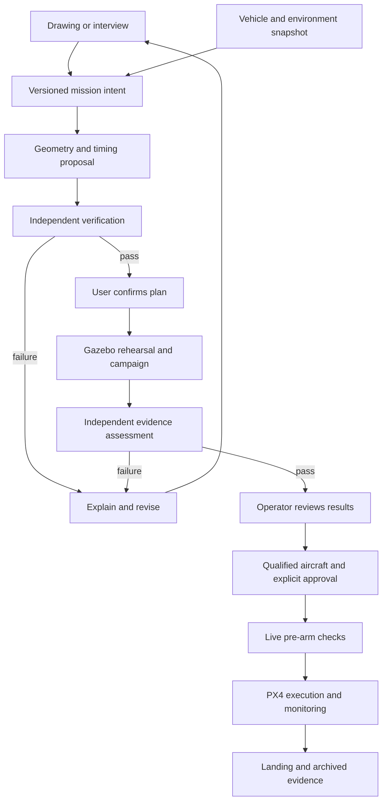

# Trajectory planner: research decisions and implementation baseline

Review date: 19 October 2026. Source baseline: PR #3, commit
`2b58bb1166dddc7f918b6d671c1005edce9066f2` of
`XpiredRuby/PX4_project_improved`. This is an engineering design and test plan.
It does not establish physical flight readiness. Status claims below distinguish
source inspection, executable offline evidence, proposed work, and owner decisions.

## 1. Product contract

Two front ends produce the same mission contract: a scaled drawing, or an
interview specifying route/pattern, altitude, speed policy, yaw, stops, and
optional deadline. The system interprets intent, proposes a smooth trajectory,
independently checks it, and overlays the proposal on the input. The user
confirms that interpretation before a real-time Gazebo rehearsal. The operator
then reviews actual-versus-planned results and explicitly approves the exact
mission for hardware, if that aircraft and operation have been qualified.

A successful simulation never automatically starts a physical aircraft. Editing
the mission invalidates the earlier confirmation and results. Every mission
includes takeoff, transition to the route, route execution, exit/return,
landing, disarm, and an evidence interval after disarm. A route-only certificate
does not cover those other phases.

The first release is an offline, static-environment planner for conventional
multicopters, using PX4's existing controller and estimator. It has no moving
obstacle avoidance, online replanning, aggressive inverted maneuvers, or learned
control policy. Those require separate requirements and validation.

## 2. Findings that change the plan

1. The source already contains a substantial spline planner, timing engine,
   independent acceptance module, interview compiler, occupancy-grid path
   search, review page, and SITL acknowledgement. Rebuilding them from scratch
   would discard useful tests. Extend the current branch.
2. The architecture's historical sections describe features as missing that
   its later sections describe as shipped. Treat the status record and source
   at the pinned commit as the baseline; keep this review as the implementation
   delta. Percent completion is an estimate, never a readiness measure.
3. A finite search finds a *certified feasible duration for its candidate
   family*. It does not prove a global minimum or that a rejected short deadline
   is impossible for every other shape and timing law. Existing
   `minimum_feasible_duration_s` fields have the narrower meaning. Future APIs
   must distinguish `feasible_duration`, `lower_bound`, `search_exhausted`, and
   `proven_infeasible`. Do not silently rename existing contracts.
4. Strict priority given to maximizing fidelity/margin before time can produce
   undesirable rounding or arbitrarily slow flight. Use explicit fidelity
   tolerances and finite reserved margins; optimize within those acceptable
   bands. Do not maximize margin without a stopping criterion.
5. In the present retimer, `target_speed_m_s` acts as a preferred speed cap,
   multiplied by `limit_scale`, rather than a guaranteed or average speed.
   The UI must display the resulting cap and predicted speed profile. A later
   schema can distinguish preferred cruise, hard maximum, and exact speed at
   a specified station; these are different requirements.
6. Standard TOPP-RA is useful for fixed-path timing but is not a drop-in
   certificate for jerk, yaw torque, rotor feasibility, or tracking. A candidate
   with acceleration jumps cannot be repaired merely by slowing those jumps.
7. The current offline comparison is sampled tracking evidence, not proof of
   continuous constraints, simulator provenance, landing, or a completed
   campaign. Complete temporal coverage and bounded logging gaps are required
   even for that narrower claim.
8. Hashes detect changes relative to a trusted record. They do not authenticate
   an operator or prevent an attacker from rewriting both data and hashes.
   Flight approval needs authenticated identity and a trusted evidence store.

Items 3–8 are engineering conclusions of this review, not results claimed by
the cited literature.

## 3. Research basis and limits

Primary references were checked on the review date. The decisions below are
project recommendations, not measured comparisons on this aircraft.

| Ref | Primary source | What it supports; what it does not establish here |
|---|---|---|
| R1 | [Pham & Pham, TOPP-RA, TRO 2018](https://arxiv.org/abs/1707.07239) | Reachability-based fixed-path parameterization; no global optimum over path shapes. |
| R2 | [TOPP-RA author documentation](https://hungpham2511.github.io/toppra/index.html) | Available constraint interfaces and duration parameterization; no project-specific rotor/jerk qualification. |
| R3 | [Pham & Pham, third-order TOPP](https://arxiv.org/abs/1609.05307) | Third-order constraints need additional treatment; ordinary second-order retiming is insufficient. |
| R4 | [Wang et al., GCOPTER/MINCO, TRO 2022](https://arxiv.org/html/2103.00190v4) | Joint spatial and temporal trajectory optimization, constraint elimination and penalties; solver convergence is not our independent acceptance proof. |
| R5 | [GCOPTER official implementation](https://github.com/ZJU-FAST-Lab/GCOPTER) | Candidate implementation and integration surface; its ROS 1 example is not a ready ROS 2/PX4 integration. |
| R6 | [Faessler et al., rotor-drag flatness, RA-L 2018](https://arxiv.org/abs/1712.02402) | Position and heading as flat outputs under a drag model; coefficients and operating envelope must be identified. |
| R7 | [Berscheid & Kröger, Ruckig, RSS 2021](https://arxiv.org/abs/2105.04830) | Jerk-limited state-to-state motion; not arbitrary drawn-path preservation or a full mission optimizer. |
| R8 | [PX4 v1.17 Offboard](https://docs.px4.io/v1.17/en/flight_modes/offboard) | Supported setpoint/frame semantics, pre-streaming and Offboard-loss behavior. |
| R9 | [PX4 v1.17 Gazebo](https://docs.px4.io/v1.17/en/sim_gazebo_gz/) | Gazebo targets, speed factor and lockstep; real-time factor must still be measured. |
| R10 | [PX4 failsafe simulation](https://docs.px4.io/v1.17/en/simulation/failsafes) and [configuration](https://docs.px4.io/v1.17/en/config/safety.html) | Native fault/fallback facilities; every configured outcome still needs project evidence. |
| R11 | [PX4 HITL](https://docs.px4.io/v1.17/en/simulation/hitl) | SITL and HITL exercise different paths; hardware support must be checked. |
| R12 | [PX4 ROS 2 guide](https://docs.px4.io/v1.17/en/ros2/user_guide.html) | Frame and messaging integration obligations if ROS 2 is introduced. |
| R13 | [14 CFR Part 107](https://www.ecfr.gov/current/title-14/chapter-I/subchapter-F/part-107) | A possible U.S. civil operating basis, including preflight responsibilities; applicability remains an operator decision. |

No external paper establishes that this repository is safe for this aircraft.
The assurance case must connect project requirements to exact software,
configuration, assumptions, tests, and residual risks.

## 4. Architecture and state transitions

| State | Required evidence to leave it | Invalidating event |
|---|---|---|
| DRAFT | Explicit scale/frame, altitude, endpoint and yaw semantics | Any edit remains a draft |
| VERIFIED_PLAN | All applicable continuous/model checks pass | Any intent/model/configuration change |
| CONFIRMED_FOR_SITL | User confirms the exact planned artifact | Edit, expiry, changed model/world |
| SIMULATED | Required processes ran and complete evidence was collected | Crash, missing/truncated logs, wrong versions |
| SITL_PASSED | Every required scenario outcome passes the declared rubric | Missing case, unexplained failure, changed artifact |
| FLIGHT_REVIEW | Identified aircraft, ODD and qualification evidence exist | Configuration or operating-domain change |
| FLIGHT_APPROVED | Authenticated approver binds exact artifact and expiry | Any binding mismatch or revocation |
| PREARM_READY | Fresh live state matches approval and validated limits | Stale state, reset/origin change, battery/weather/map violation |
| EXECUTING | Continuous supervision and independent intervention path | Failure invokes the validated fallback |
| COMPLETED | Landing, disarm, output shutdown and logs confirmed | Missing evidence prevents a completion claim |

These are target product states. The current repository does not implement the
complete release state machine. Its SITL acknowledgement cannot substitute for
`FLIGHT_APPROVED`.

The UI owns input and review. It does not own command authority. The compiler
owns proposals; the verifier owns mathematical acceptance; the campaign runner
owns simulation provenance; the evidence assessor owns campaign decisions;
the approved runtime owns execution. Keep simulator truth available only to
evaluation, never to the controller's estimated-state feedback.

## 5. Input requirements and proposed defaults

First-release defaults are visible, serialized **SITL policies**, not aircraft
facts: horizontal drawing in metres, launch-relative height, explicit NED
transform, rest-to-rest mission, fixed heading unless selected otherwise,
0.5 m geometric tolerance, 0.9 dynamic limit scale, no deadline. The existing
x500 model caps speed at 3 m/s; the demo requests less. A desired 5 m/s research
mission therefore needs model and controller reconciliation before validation.

| Question | Required interpretation |
|---|---|
| What does the drawing represent? | Horizontal/vertical/3-D plane, units, scale, origin and orientation. A screenshot alone is not a metric map. |
| How high? | Fixed height/profile plus launch/MSL/terrain datum. Terrain following needs a bound terrain source. |
| How close to the drawing? | Maximum deviation plus mandatory points; show changed corners and stop insertions before confirmation. |
| How fast? | Preferred cruise versus hard speed maximum. Stops imply zero speed even if cruise is nonzero. |
| What heading? | Fixed, tangent, look-at, explicit profile; report undefined heading at vertical/zero-tangent segments. |
| Stops and loops? | Stop, exact fly-through, repeat count, entry, exit, and final braking/landing behavior. |
| How soon? | Optional soft preference, maximum, or exact arrival. Explain search limits without claiming a nonexistent global proof. |
| Where may it fly? | Geofence, cleared volume or map version, exclusion regions, vehicle envelope and uncertainty. |
| Which aircraft? | Qualified configuration ID; no implicit swap based on a display name. |
| What happens on failure? | Approved response per failure, position validity and available landing/return region. |

Roll and pitch normally follow the acceleration required by the route. Expert
attitude inputs would change the product from position/yaw planning to a
separately qualified maneuver planner. Do not expose them as independent normal
mission sliders.

### Circle and corner semantics

A circle is continuously turning, with lateral acceleration `v²/r`; even an
ideal circular flight has jerk as its acceleration direction rotates. Entry,
exit and braking need derivative continuity. A seam does not require a stop
unless requested. The current stopped-loop implementation is a baseline, and
its unrolled entry/exit mode can fly through intermediate seams. A fully
continuous periodic schedule remains separate work.

For a constant-height ideal circle in still air, `tan(tilt) = v²/(g r)` and
`thrust = m sqrt(g² + (v²/r)²)`. These are explanatory identities, not complete
rotor or tracking certificates. For a sharp corner with zero rounding and
nonzero speed, the system must insert an approved stop or reject the request.
It cannot preserve an instantaneous velocity-direction change.

Symmetric nearest-distance bounds alone do not preserve traversal order at
self-intersections. Record station ordering, traversal direction, loop count
and mandatory passages. Reject ambiguity in the editor. This ordered-fidelity
check is an additional requirement beyond the present distance tube.

## 6. Optimization policy that cannot choose an hour-long flight

Use constrained tiers, with explicit slack/acceptability bands recorded in the
mission, rather than one opaque weighted cost:

1. Satisfy all hard legality, environment, vehicle, endpoint and numeric checks.
2. Remain within the user's accepted geometric/semantic bounds, including
   ordered passage. Preserve mandatory points and approved stops.
3. Meet prescribed tracking/control reserves and a measured whole-mission
   energy budget. Seek smoothness improvements only up to a declared useful
   target or improvement tolerance.
4. Within those acceptable bands, reduce duration and unnecessary path length.
   If the preferred speed is feasible, approach it away from transitions;
   slow for corners, yaw and braking. Record the binding constraint.

For optimization research, report a Pareto curve of fidelity, control effort,
duration and minimum margins. Select a policy using the accepted bands. A
global solver proof is optional research; truthful feasibility and bounded
suboptimality claims are mandatory product behavior.

For `r(t)=p(s(t))`, independently check:

`v = p' s_dot`

`a = p'' s_dot² + p' s_ddot`

`j = p''' s_dot³ + 3 p'' s_dot s_ddot + p' s_dddot`

Yaw derivatives use the same chain rule. If rotor torque is certified from
flatness, derivatives through snap and yaw acceleration can be needed. The
state/input map and its singularities must be verified for the chosen model.
Slowing time scales velocity, acceleration, and jerk by `1/T`, `1/T²`, `1/T³`
for an otherwise fixed normalized schedule; it does not remove discontinuities.

For the future identified model, use a documented frame convention and
`m a = m g_vector + R thrust_body + force_drag`. Recover attitude, body rates,
angular acceleration and required wrench, then test the *coupled* rotor set:
`B f = wrench`, with voltage-dependent lower/upper bounds on every rotor,
slew limits, and uncertainty. Independent checks of total thrust and yaw
torque are not sufficient when roll/pitch consume the same rotor authority.

## 7. Trade studies and decision record

### 7.1 Geometry / joint planning

Apply hard gates before scoring: explicit output, deterministic replay under a
pinned setup, compatibility with an independent verifier, and no silent
relaxation of intent. A score never overrides a failed gate. Numbers below
are this reviewer's ordinal judgments, not benchmark results or probabilities.
Criteria: ease of independent bounding (B) 30%, intent editing/fidelity (F)
25%, dynamics/space-time coupling (D) 25%, integration maturity here (I) 20%.

| Candidate | B | F | D | I | Weighted /5 | Decision |
|---|---:|---:|---:|---:|---:|---|
| Current quintic spline + certified timing | 5 | 5 | 3 | 5 | 4.50 | Baseline and fallback; already integrated |
| Fixed-time minimum-snap polynomial | 4 | 4 | 3 | 3 | 3.55 | Research comparator; needs time allocation |
| MINCO/GCOPTER adapter | 3 | 4 | 5 | 2 | 3.55 | Joint-optimization research branch after baseline SITL |
| General direct collocation | 3 | 3 | 5 | 1 | 3.10 | Small-case reference, if needed for optimality comparisons |

Sensitivity: if dynamics weight rises to 50% and B/F/I become 20/15/15%,
the baseline and MINCO each score 4.00. With dynamics at 60% and B/F/I at
15/15/10%, MINCO scores 4.25 and baseline 3.80. This changes which method is
worth researching, not which is qualified. Current integration evidence still
favors the baseline for first demonstrations. Re-score using measured results
after the benchmark rather than treating these judgments as a permanent rank.

### 7.2 Timing engines (a separate subproblem)

| Candidate | Benefits | Critical gap | Decision |
|---|---|---|---|
| Current monotone spline schedule | Per-span conservative bounds; rest-to-rest; no new dependency | Conservative, finite candidate search; no global optimality | Ship baseline |
| TOPP-RA | Preserves fixed geometry; useful timing comparator [R1,R2] | Standard formulation does not settle our jerk/full-actuator checks [R3] | Candidate generator only; smooth and independently recheck |
| Ruckig | Useful bounded state-to-state transitions [R7] | Multi-axis synchronization does not preserve an arbitrary drawn curve | Evaluate takeoff/exit/braking, with corridor re-verification |
| Joint MINCO optimization | Can improve shape and timing together [R4] | Nonconvex convergence/penalties and wider integration scope | Later candidate generator with baseline fallback |

Do not run TOPP-RA over x/y/z independently and assume that the result stays on
the accepted path. Any geometry-changing transition consumes the same fidelity
and clearance budgets as the main planner.

### 7.3 Environment and execution

| Decision | Alternatives | Selected basis and revisit trigger |
|---|---|---|
| Map | Known-clear test volume; 2-D occupancy; 3-D voxel/ESDF | Clear volume for first SITL; grid only with explicit height/extrusion assumptions. 3-D obstacles need 3-D representation. |
| Topology | Current 4-connected search; A*; seeded RRT* | Preserve current deterministic search baseline. Evaluate A* to reduce detours; no diagonal corner cutting without clearance checks. |
| Controller interface | Existing pymavlink; MAVSDK; ROS 2/uXRCE-DDS | Preserve pymavlink and existing watchdogs. Adopt ROS 2 only for a concrete sensor/compute requirement. [R8,R12] |
| Simulator | Existing PX4/Gazebo; alternative simulators | Use the existing x500 target for comparable evidence. Pin exact PX4, Gazebo, world/model and parameter versions. [R9] |
| Acceptance | Sparse samples; conservative continuous bounds | Continuous bounds for planned feasibility; sampled truth/estimates for tracking, with explicit logging limits. |
| Learning | End-to-end policy; learned proposal; no learned component | No neural network required. No training data or bounded failure argument currently justifies a policy. A future learned proposal must pass the same verifier and improve a declared benchmark. |

### 7.4 Dependency policy

Keep the first increment on current Python/numpy tooling and the established
controller. Pin versions and solver tolerances for reproducible experiments;
record CPU, OS and floating-point settings. Before adding TOPP-RA or GCOPTER,
check their exact version, license, build reproducibility and maintenance state.
The current lower-bound-only requirements file is not a reproducible lockfile.
Do not replace the validated environment with untested package upgrades merely
because newer packages exist.

## 8. Additional traceable requirements

These augment the existing INT/VEH/ENV/PLN/VER/SIM/EXE/HMI/LOG matrix. Status
is deliberately scoped to the review increment; existing baseline tests still
apply to their original requirements.

| ID | Requirement | Acceptance method | Status |
|---|---|---|---|
| INT-008 | Reject duplicate JSON keys, silently coerced booleans/integers and unused pattern fields | Adversarial parser tests | Implemented in this increment |
| INT-009 | Preserve route order/direction at crossings | Reversed/self-crossing adversarial geometry | Planned |
| INT-010 | Serialize speed semantics, effective cap and optimization scope | UI/API round-trip and limit tests | Partial: review documentation; schema migration planned |
| PLN-009 | Distinguish found feasible duration from proven lower bound/infeasibility | Known solvable short-deadline counterexamples | Summary scope and refusal wording implemented; contract field migration planned |
| PLN-010 | Limit smoothness/margin tiers by explicit finite targets | No gratuitous waits on straight/circle cases | Planned |
| PLN-011 | Verify full start/route/exit/return/landing composition | Phase-boundary and geofence tests | Nominal lifecycle and sampled truth tested; continuous composition certificate remains planned |
| VER-006 | Check coupled, identified rotor allocation and slew | Wrench saturation/cross-axis adversarial cases | Owner/model blocked |
| VER-007 | Include tracking, map, localization, latency and body envelope in clearance | Independent inflation and collision oracle | Partial grid baseline; complete budget planned |
| SIM-005 | Require complete mission-clock track coverage and bounded sample gaps | Truncation, missing-middle and timestamp tests | Implemented in this increment |
| SIM-006 | Require process/configuration/log provenance and scenario completeness | Kill process, remove log, swap digest | Owned process, isolated runtime, parameter readback, provenance and digest tests implemented; wider infrastructure faults planned |
| SIM-007 | Compare estimator and simulator truth separately | Inject bias while estimates track the plan | Nominal and GPS-outage truth evaluated; deliberate biased-estimate campaign planned |
| SIM-008 | Measure wall time, simulation time and achieved real-time factor | Pause/slow/load cases | Requested 1× measured on live runs; pause/slow/load cases remain planned |
| HMI-004 | Confirm interpretation before simulation; approve exact results separately for hardware | State-machine and stale-result tests | Drawing/interview browser QA passed; exact-artifact connected SITL workflow implemented; physical release blocked |
| EXE-005 | Authenticate approval and deny stale/replayed/changed artifacts | Identity, expiry, replay and live-bind mutation tests | Physical release blocked |
| LOG-002 | Retain immutable manifests, logs, checksums, seeds and result rubric | Reproduce report on a clean environment | Per-run logs, hashes and rubric retained; independent clean-machine reproduction remains planned |

## 9. Experiments and decision gates

### Gate A: offline correctness

Run existing repository validation, then dedicated adversarial tests. Include
duplicate JSON fields, NaN/Inf, boolean-as-integer, incorrect stop flags, wrong
frames, self-intersections, exact cusps, near-zero tangent, all yaw modes,
hard-stop seams, insufficient map extent, unknown cells, map swaps, duplicate
timestamps, partial tracks and missing samples. Property checks should show
that tightening a hard bound never increases the accepted bound and that
changing any bound input changes the evidence binding.

An independent verifier should increasingly use separate implementations:
sharing the optimizer's spline evaluator/bounds can leave common-mode bugs.
Differential finite-difference and interval tests help, but are not complete
independence. Record which code is shared.

### Gate B: deterministic planner benchmarks

Use straight routes, an L turn, a hairpin/cusp, a figure-eight, a circle at
several radii, multiple laps with entry/exit, stop points, vertical motion,
lawnmower turns, and a mapped corridor. Keep original intent, model, reserve
and error budgets identical across methods. Sweep tolerance, desired speed,
yaw demand and model limits. Include cases expected to be refused.

Compare baseline, TOPP-RA-derived candidates and MINCO candidates only when
each passes the same independent verifier. Report max and ordered geometric
error, path length, duration, integrated squared jerk/snap (a smoothness proxy,
not energy), all certified margins, planning time and failure/refusal rate.
Use a valid lower bound such as length divided by hard speed limit, labeled
as loose; account for endpoint conditions when constructing tighter bounds.
Do not compare library demo timings against local code on different hardware.

### Gate C: live nominal Gazebo

First reproduce the existing five-stop controller result without changing its
control law. Then drive the general planner artifacts through the same runner.
Run a visible 1x rehearsal, measure achieved real-time factor, and archive video
plus machine-readable evidence. Video is explanatory, never the acceptance
oracle. Faster batch runs may supplement, not replace, the requested real-time
rehearsal.

Predeclare thresholds. The following are **initial research targets for SITL**,
not accepted physical limits; revise only with recorded rationale before a new
campaign, never after examining individual runs to make them pass:

| Metric | Proposed initial target | Measurement |
|---|---|---|
| Planned geometry/dynamics | Every applicable continuous bound passes the configured reserve | Independent certificate |
| Position tracking | p95 <= 0.5 m; sampled maximum <= 1.0 m | Time-aligned truth versus planned position; estimates separately |
| Heading tracking | p95 <= 5 deg; sampled maximum <= 10 deg | Wrapped error with explicit launch-frame transformation |
| Track logging | No missing start/end, no duplicate/regressed time; gap <= 0.25 s | Coverage checker; denser capture retained |
| Setpoint stream | Retain current nominal 20 Hz and stricter existing watchdog | Actual transmitted timestamps; PX4's >2 Hz is only its liveness floor [R8] |
| Touchdown | <= 1 m from approved landing point, horizontal speed <= 0.2 m/s and vertical speed magnitude <= 0.2 m/s at contact | Truth, estimator and contact/land-detector agreement |
| Shutdown | Confirmed disarmed plus at least 2 s of fresh zero actuator output evidence | Heartbeat and actuator records |
| Obstacle clearance | No contact and positive predeclared clearance budget, including tracking reserve | Truth pose/body envelope against independently checked map |
| Real-time rehearsal | Report factor distribution and pause events; target mean 0.95–1.05 at requested 1x | Simulation-time/wall-time intervals |

A 0.5 m geometric smoothing tolerance and a 1 m tracking maximum are separate
budgets. The product must show their combined effect on distance from the
drawing and on obstacle clearance; it cannot claim the flown track remains
within 0.5 m because the planned curve does.

Nominal runs must complete all required lifecycle phases. Fault runs may be
expected to abort; their pass condition is the specified bounded fallback,
not completion of the nominal route.

### Gate D: fault and uncertainty campaign

| Fault family | Cases | Required outcome basis |
|---|---|---|
| Disturbance/model | Wind directions, gust onset at corners, mass/CG/thrust/drag bounds, battery sag | Reserved control and clearance; no modeled limit violation |
| Estimation | GNSS loss/stale/bias, localization drift, estimator reset/origin change | Detect, stop using stale evidence, validated hold/land/return policy |
| Map | Stale/missing/swapped grid, unknown regions, obstacle perturbation | Refuse before arm or bounded abort as specified |
| Transport/compute | Delay/drop/reorder, CPU stress, planner/runner death, stream stall | Command expiry and PX4 fallback; no stale replay |
| Mission/authority | Arm rejection, mode change, operator takeover, changed hash, expired review | No unauthorized command or automatic resume |
| Power/containment | Low battery, geofence approach/crossing | Predeclared PX4 action and safe evidence outcome |
| Evidence failure | Missing truth, truncated telemetry, process crash, disk failure | No campaign pass or launchable artifact |

The source architecture records a failed combined gust/12-second GNSS case.
It remains a documented boundary, not evidence of robustness. Preserve that
case as an expected limitation until a new design and tests resolve it.

Start with deterministic boundary cases, then seeded Monte Carlo with frozen
distributions. Trials must be independent enough for the statistical claim;
many correlated time samples in one flight are not many trials. With zero
failures in `n` independent Bernoulli trials, the one-sided 95% upper bound is
`1 - 0.05^(1/n)`. Thus 299 zero-failure trials support a bound below 1%, and
2,995 support a bound below 0.1%, under the stated sampling model. Neither
supports a universal safety claim. Hardware reliability/mission risk targets
remain owner decisions.

### Gate E: hardware qualification and operational release

Identify the airframe configuration and uncertainty, including allocator,
thrust/voltage, mass/CG, inertia, sensors, latency, compute load and energy.
Use compatible hardware simulation where available [R11], propeller-off bench
tests, independent override, bounded first flights and incremental envelope
expansion. Confirm operating basis and site/airspace conditions [R13]. Archive
test cards, abort criteria, maintenance/configuration changes and approver.

Every subsequent mission requires its own confirmed plan, successful applicable
simulation, fresh review, approval, and live-state match. A prior successful
circle does not qualify a changed map, aircraft, yaw profile or payload.

## 10. Work sequence and completion criteria

### Hazard register to maintain through implementation

Severity below is a qualitative engineering screening judgment. Exposure,
probability, accepted residual risk and responsible named owner remain to be
established for the aircraft and site; no numerical safety score is inferred.

| Hazard | Potential severity | Required prevention or response | Evidence before physical release |
|---|---|---|---|
| Wrong scale, datum, yaw or origin | High: route leaves intended volume | Explicit transforms, overlay, launch binding and reset detection | Frame mutations and live-origin reset tests |
| Smoothed corner enters obstacle | High: collision | Combined geometry/body/map/localization/tracking clearance budget | Independent continuous clearance and truth-based tracking tests |
| Wrench or battery margin exhausted | High: loss of control or forced landing | Identified coupled allocation, power reserve and bounded ODD | Bench identification, voltage/load boundary tests and mission energy evidence |
| Stale command continues after compute loss | High: unintended motion | Existing command expiry, independent supervision and PX4 fallback | Process-kill/stall and actual setpoint-age traces |
| Position estimate is fresh but wrong | High: collision or departure | Innovation/quality supervision, uncertainty budget and defined lost-position action | Biased-estimate scenarios evaluated against simulator truth |
| Old approval reused after edit | High: unintended mission | Exact artifact/configuration binding, expiry and authenticated authority | Replay, mutation and concurrent-edit tests |
| Truncated or substituted simulation accepted | High: untested mission is launched | Provenance, complete-case manifest, coverage/gap checks and fail-closed assessor | Crash/log removal/digest substitution tests |
| Landing/return transition omitted from plan | High: terminal collision | Full lifecycle geometry, reserved energy and approved terminal region | Transition/return/contact/disarm evidence |
| Operator misreads an optimistic result | High: launch outside qualified domain | Separate mathematical, simulation and flight states; show assumptions | Human review exercises and state-transition tests |

Each hazard must ultimately have a named owner, linked requirements, linked
tests and recorded residual-risk disposition. This table is a starting register,
not a completed operational risk assessment.

| Increment | Concrete deliverable | Exit criterion |
|---|---|---|
| A | Research review, strict input corrections and complete-track checking | Adversarial tests pass and scope is documented |
| B | Local drawing/interview editor with route overlay and timing/limit plots | Both inputs compile through the existing verifier; errors visible; no hardware authority |
| C | Nominal Gazebo orchestration and complete evidence bundle | Reproduce baseline then general missions on simulator machine |
| D | Scenario assessor, invalidation state machine and real-time rehearsal | Missing/failing/stale results cannot advance review |
| E | TOPP-RA and MINCO adapters, finite-tier policy and benchmark comparisons | Measured benefit under the same verifier; baseline fallback retained |
| F | Ordered fidelity, 3-D map/uncertainty and full actuator model | Declared scope has positive continuous margins |
| G | Identified aircraft, hardware integration and flight release | Owner decisions, qualification evidence and authenticated approval |

Increments may be split into reviewable changes, but no downstream gate is
marked complete from upstream unit tests alone. Do not merge or promote a
release solely because a test count increased.

## 11. Human inputs and actual blockers

Software research, parser fixes, offline planning and a SITL editor can proceed
without aircraft choices. Live simulation needs access to the machine with
PX4/Gazebo. The connected Windows/WSL machine is now available. Live baseline, drawing
and circle missions have completed their original lifecycle audits. The stricter
independent truth assessment found a startup heading transient; the command
handoff was corrected and all three repeated nominal cases passed unchanged
sampled targets. The connected browser rehearsal and GPS-outage response also
passed; see the checkpoint for the control-stall outcome and remaining scope. See
`trajectory_studio_connected_validation.md` for exact commits and outcomes.

Before physical qualification, the owner must supply the ten decision groups
already listed in architecture section 11: aircraft/configuration; operating
basis; operating domain; obstacle/map source; drawing/altitude interpretation;
fidelity/stops; yaw/expert scope; failures/manual override; confidence targets;
and evidence/operator/approver roles. Ask these at the gate that needs them.
Do not stall offline work on physical choices or invent aircraft capabilities.

The immediate technical choices to resolve with the owner are: the intended physical
aircraft/sensors; and whether the previous 200 m / 5 m/s objective remains the
target after initial conservative x500 validation. A 200 m *path length* need
not imply a 200 m operating radius; these must be distinguished explicitly.

## 12. Defensible claim

The target claim is reproducible and bounded: this exact version/configuration
meets these requirements under these assumptions, passed these tests, and has
these known limitations. “100% safe,” “all physics validated,” or “globally
optimal” are not substitutes for that evidence. The system must make its
assumptions and any unverified physics visible at review and at release.
