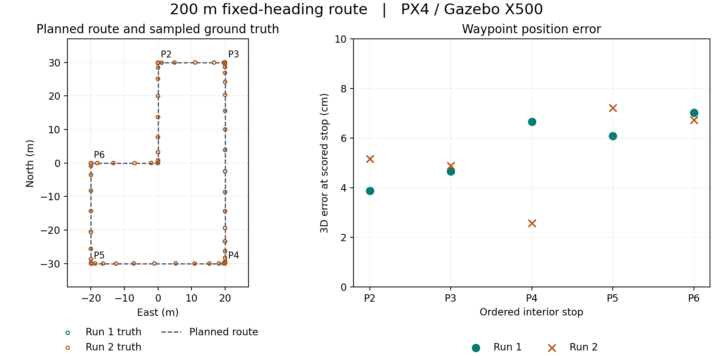

# 200 m PX4 / Gazebo rehearsal

Four headless X500 trials ran the same 12 m altitude, fixed-heading reference in the flat Gazebo validation world. The route starts over launch, visits five interior stops, and returns home. PX4 handled takeoff, landing, and disarm. The original CSV SHA-256 was `f341ac377cde90fd84fa48c53b0750477d8ed441151e5dd94a3682e5a9af698f` in all four trials.

| Trial | Campaign | Route RMS (m) | Route p95 (m) | Offboard p95 (m) | Max stop error (m) | Landing error (m) |
|---|---|---:|---:|---:|---:|---:|
| [Baseline 1](052ba31a9672fe9bec5bc4d0665bdd3c.json) | Pass | 0.271 | 0.509 | 0.495 | 0.061 | 0.029 |
| [Baseline 2](af94919059860ac893620e9ec213a2c1.json) | Fail | 0.267 | 0.513 | 0.501 | 0.068 | 0.071 |
| [Adjusted 1](7f38b2276bd690b02ba8c5f3ac0b21ee.json) | Pass | 0.189 | 0.340 | 0.334 | 0.070 | 0.073 |
| [Adjusted 2](3286e712f94120d30d2159e4f96dd9f1.json) | Pass | 0.167 | 0.294 | 0.289 | 0.072 | 0.087 |

The campaign applies the 0.500 m p95 position threshold across takeoff, route, return, and alignment. Baseline trial 2 exceeded it by 0.001 m. Both adjusted trials used 0.45 s of horizontal velocity lead on route acceleration, retained the original reference, and used the same scoring thresholds.

Studio scored each required stop within one second of its planned event, using simultaneous 3D error ≤0.50 m and observed speed ≤0.25 m/s. Landing error uses horizontal ground truth at the first PX4 on-ground report relative to the logged landing target. Independent final-ground checks required disarm and all four actuator outputs at zero for two continuous seconds.

The route was sampled at 20 Hz and planned to peak at 2.646 m/s within the 3 m/s model envelope. The two adjusted trials qualify this benchmark for local simulation. A 5 m/s cruise or 0.1 m/s descent configuration requires its own trials.

Each JSON file includes source artifact hashes, the ordered stop measurements, and decimated local north/east/down positions in metres for visualization. The full flight logs, assessment, and manifests are on the laptop in `~/PX4-studio-200m-runs/<plan_id>/rehearsal/reviewed-plan/` in the PX4-Research-R WSL distribution.

