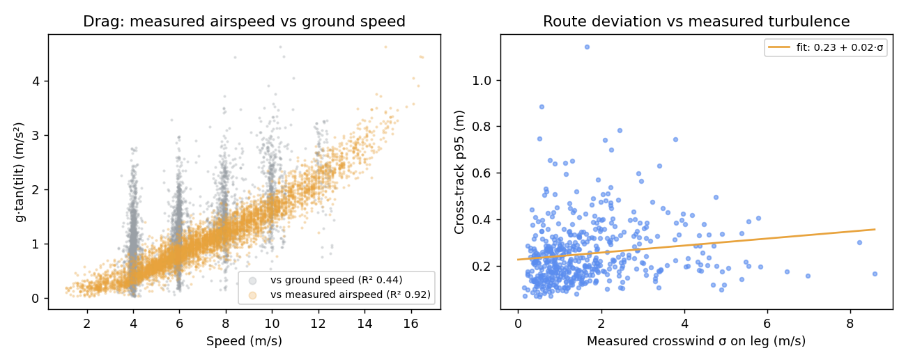

# Measured wind: drag and gust response (CMU DJI Matrice 100)

Date: 2026-11-23. Data: Rodrigues et al., *Scientific Data* 8:155 (2021); data record doi:10.1184/R1/12683453 (CC BY 4.0).
196 route flights of a DJI Matrice 100 carrying an FT205 ultrasonic anemometer, 5 Hz, GNSS/INS position, attitude, battery power.

## Frames (verified, not assumed)
- Velocity columns are body-frame: rotating by the logged quaternion reproduces GNSS east/north motion (r = 0.996).
- The anemometer is uncorrected relative airflow. Of eight candidate conventions, world-frame compass bearing of the
  direction the air comes from gives the steadiest derived wind across headings (about 2x steadier than any other).

## 1. Drag: measured airspeed vs ground speed
Steady level cruise, drag per mass = g·tan(tilt), 52,971 samples.

| Regressor | k1 (1/s) | k2 (1/m) | R² |
|---|---|---|---|
| Measured airspeed (anemometer) | 0.083 | 0.0085 | **0.92** |
| Ground speed (what PX4 logs allow) | 0.187 | 0.0012 | 0.44 |

Ground-speed drag fits are wind-contaminated. This confirms, with measured wind, that the X500 fleet's high tilt-based
drag is mostly unmeasured wind; Studio no longer uses it for wind response.

## 2. Gust response: route deviation vs measured crosswind turbulence
506 straight legs (3.9-11.9 m/s ground speed). Cross-track is measured from each leg's best-fit line, so it captures
gust-driven wander, not a steady offset.

- p95 cross-track ≈ 0.23 m + 0.015 m per m/s of crosswind σ (R² 0.02): the autopilot rejects gusts well.
- Published conservative coefficient: 95th percentile of (p95 cross-track above the GNSS floor) / σ = **0.25 m per m/s**.
- Studio's accuracy corridor now uses this coefficient times the forecast crosswind σ (Dryden lateral intensity or the
  forecast gust spread, whichever is larger), replacing a model that was about 5x more pessimistic.

## Limits
Different airframe (about 3.6 kg) and autopilot (DJI, not PX4); metre-level GNSS position; anemometer not corrected
for rotor downwash. Along-track error and stop accuracy in wind are not covered.

Reproduce: download `flights.zip` and `parameters.csv` from the data record, unzip, then
`python scripts/score_measured_wind.py DATA_DIR validation/2026-11-23-measured-wind`.
